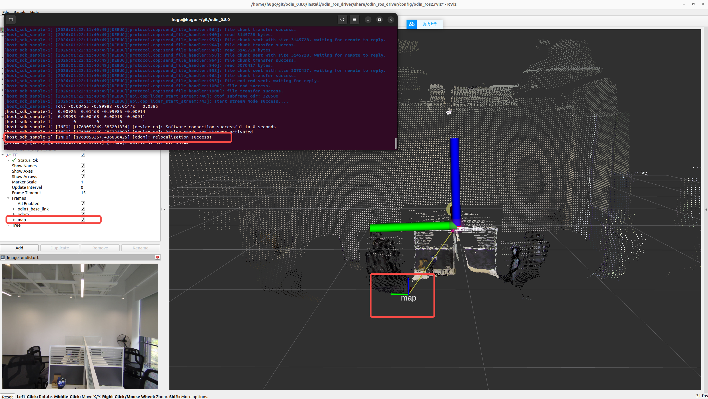

# 10. Odin1 重定位功能
## 10.1 说明
> Odin1目前支持三种使用模式：ODOM里程计模式、SLAM模式和Relocalization重定位模式。模式切换均通过修改/catkin_ws/src/odin_ros_driver/config/control_command.yaml文件中“custom_map_mode”参数进行配置

> Odin1静止状态下重定位可能会出现定位匹配错误或者匹配不上定位不成功的情况，建议在此场景中，保证设备安全的情况下进行前后或者旋转移动，可以加速定位和提供定位稳定性和成功率。

## 10.2 使用教程

- step1: 设置“custom_map_mode=1”启用SLAM模式，开始录制地图，该模式下在录制的点云在回到相同场景时候会进行回环检测。
  
- step2: 当地图采集完成后请勿直接“Ctrl+c”退出驱动，需要另起终端进入/catkin_ws/src/odin_ros_driver路径下运行“./set_param.sh save_map 1”等待驱动运行终端提示地图保存完成后方可停止。此时会在用户指定目录下生成地图bin格式文件，如果用户未设置，则默认会以结束时间戳命名保存在map文件夹中。
  
- step3: 在control_command.yaml文件中修改“custom_map_mode=2”并设置地图保存路径（精确到文件后缀）。如：/home/hugo/map/office.bin
  
- step4: 重新运行驱动，Odin无法再静止状态下进行重定位，建议运行驱动后机器移动一段距离。重定位成功可以看到终端提示“[INFO] [1769564323.183375282] [odom]: relocalization success!”，且/tf中出现/map坐标系。

> 建议进入重定位模式后如果定位不成功或者定位有偏差，需要平台进行左右旋转或者前后移动，使得odin看到的场景有变化，才能准确定位。

