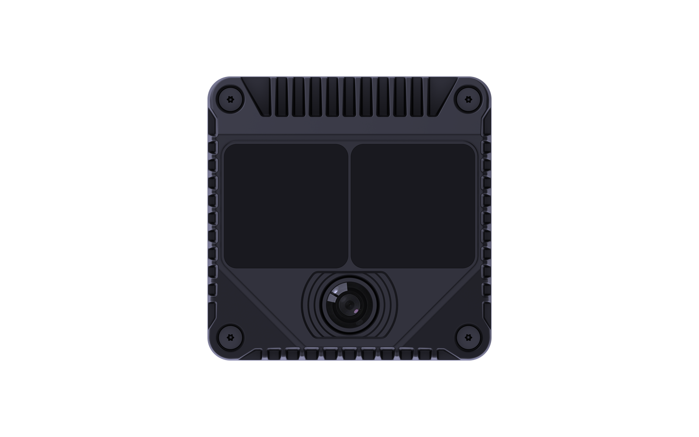
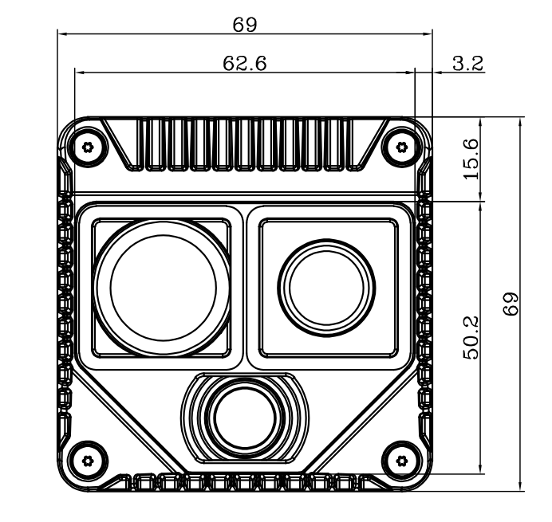
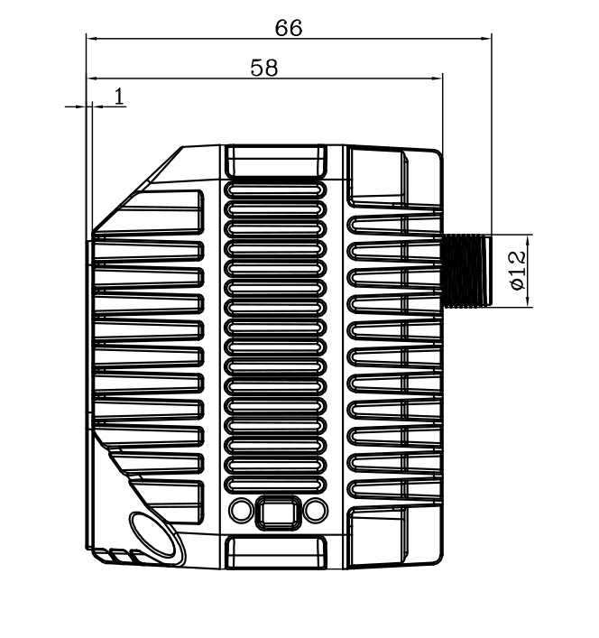

# 1. 产品概述

## 1.1 产品简介

### MindPalace Odin1 Lite：紧凑型空间记忆模组

> **为机器人、无人机及各类前研智能设备而生**

深度融合 LiDAR 与视觉传感器，实现高精度、广视角的实时三维感知，内置 MindSLAMTM 高性能融合 SLAM 算法，实现持久空间记忆。适合对尺寸和成本敏感的机器人、自主导航平台与智能边缘设备的快速集成与部署，可在室内外复杂环境中稳定运行。

## 1.2 外观尺寸

### 产品外观

### 产品尺寸

| 前视图 | 右视图 |
|:---:|:---:|
|  |  |

---

[← 返回首页](index)　｜　[下一章：硬件说明 →](2.%20HW%20Description_)
