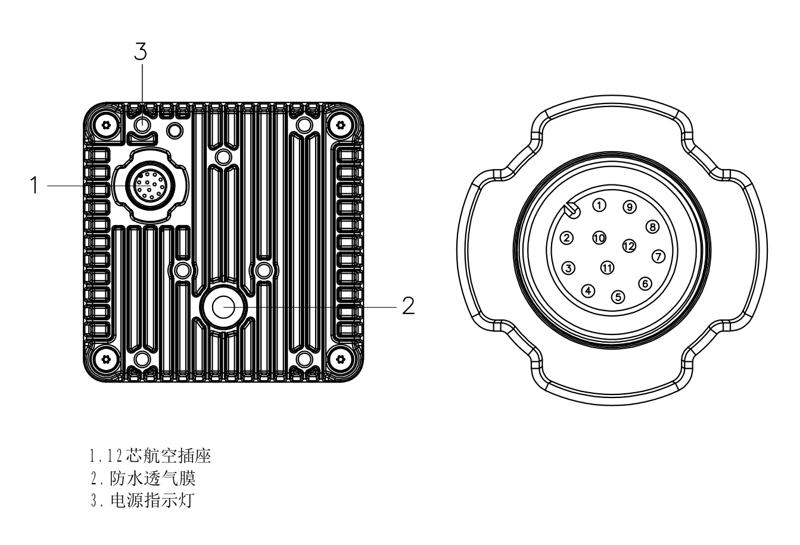
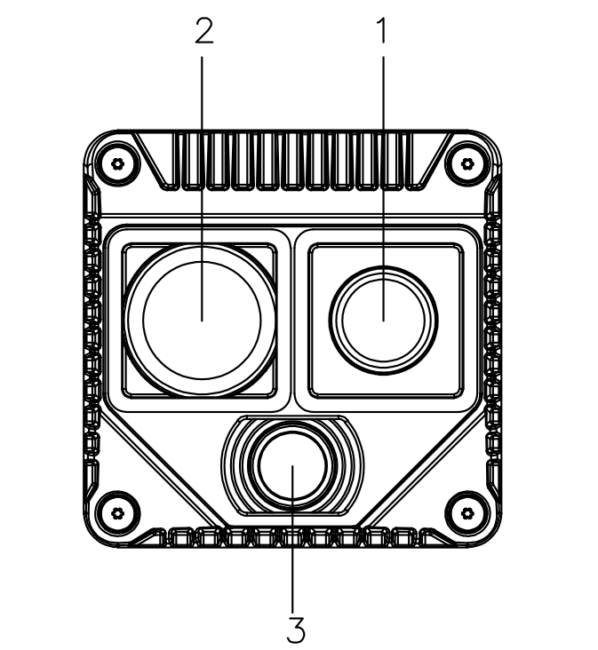
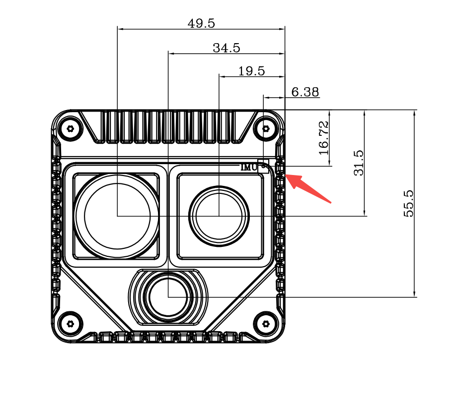
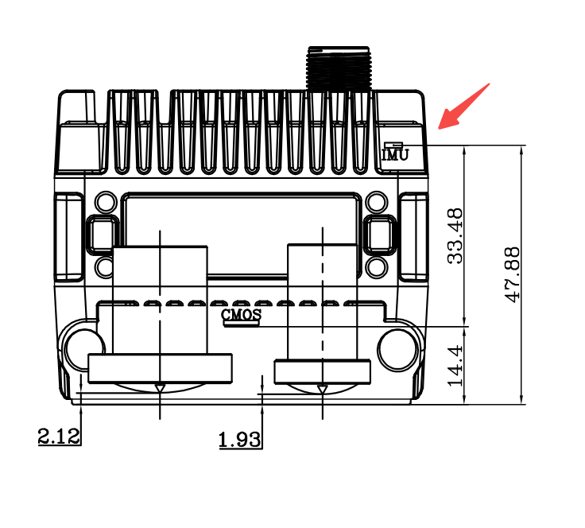
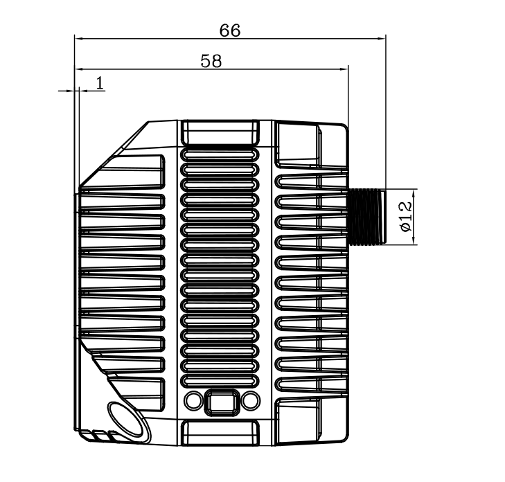

# 2. 硬件说明

## 2.1 物理接口

Odin1 Lite 仅有一个航插接口，通过随机配件 **电源数据一分二航插线** 同时实现供电与数据传输：

| 序号 | 接口类型 | 线缆 | 功能描述 |
|:-:|:-:|:--|:--|
| 1 | 航空插头（机端）| 电源数据一分二航插线 | 同时承担供电 + 千兆以太网数据传输 |
| 2 | DC 头（线端）| 5.5×2.1mm DC 公头 | 接 12V/2A 适配器 |
| 3 | RJ45（线端）| 千兆以太网 | 接 PC 网口或交换机 |

## 2.2 接口定义

Odin1 Lite 采用 **12 芯航空插座**，同时承担供电、千兆网口与外部同步信号，管脚线序如下：

| 管脚 | 信号 | 属性 | 功能 |
|:-:|:-:|:-:|:--|
| 1 | DC+ | 数据 | 千兆网口信号 |
| 2 | VIN | Power | 供电正极 |
| 3 | DB− | 数据 | 千兆网口信号 |
| 4 | DB+ | 数据 | 千兆网口信号 |
| 5 | DD+ | 数据 | 千兆网口信号 |
| 6 | DD− | 数据 | 千兆网口信号 |
| 7 | DA+ | 数据 | 千兆网口信号 |
| 8 | DA− | 数据 | 千兆网口信号 |
| 9 | DC− | 数据 | 千兆网口信号 |
| 10 | GPIO_OUT | GPIO | 外部同步触发信号输入 |
| 11 | GND | Power | 供电负极 |
| 12 | FSYNC_OUT | GPIO | 同步触发信号输出 |

> 千兆网口采用 4 对差分线：DA±、DB±、DC±、DD±，对应 1000BASE-T 标准。

## 2.3 核心部件

| 序号 | 部件 | 说明 |
|:-:|:--|:--|
| 1 | 激光发射端（TX）| dToF TX |
| 2 | 激光接收端（RX）| dToF RX |
| 3 | RGB 相机 | 1280×1088 |

## 2.4 IMU 位置关系

> **说明**：IMU 与 Body_base_link 为同一物理位置，仅命名不同。以下图纸展示 IMU 在设备外壳内部的安装位置及与各传感器之间的空间关系。

| 正视图 | 侧视图 | 俯视图 |
| :---: | :---: | :---: |
|  |  |  |

| 项目 | 说明 |
|:--|:--|
| IMU 位置 | IMU 位于设备内部，紧固于主结构件上，与 LiDAR 光学中心及 RGB 相机（CMOS）处于同一刚体结构 |
| Body_base_link 坐标系 | IMU 坐标系即 Body_base_link 坐标系，原点位于 IMU 芯片几何中心 |
| 与外壳关系 | IMU 紧固于设备主结构件上，外壳变动不影响 IMU 与 LiDAR / 相机之间的外参 |
| 安装方向 | 设备支持任意方向安装，IMU 会自动校准到重力系 |

## 2.5 网络参数

| 项 | 值 | 备注 |
|:--|:--|:--|
| 设备出厂 IP | `192.168.1.251` | **支持修改** |
| 通信协议 | UDP（数据）+ HTTPS / mTLS（文件传输）| 端口 60000–60010、59000–59005、8080 |
| HTTP Dashboard | `http://192.168.1.251:8080` | 设备状态 / 标定 / OTA / 网络配置 |

## 2.6 数模文件

> **TODO：上传 Odin1 Lite 航插头数模文件（stp）并更新链接**

- [下载 Odin1 Lite 航插头数模文件（stp）](assets/stp/o1_lite线缆直头.stp)
- [下载 Odin1 Lite 航插头数模文件弯头（stp）](assets/stp/o1_lite线缆弯头.stp)

---

[← 上一章：产品概述](1.%20Product%20Overview_)　｜　[下一章：安装指南 →](3.%20Installation%20Guide_)
