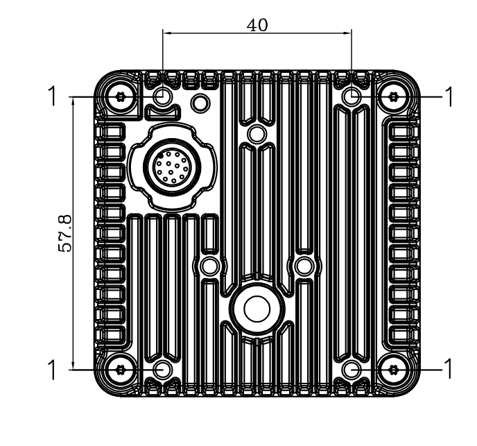
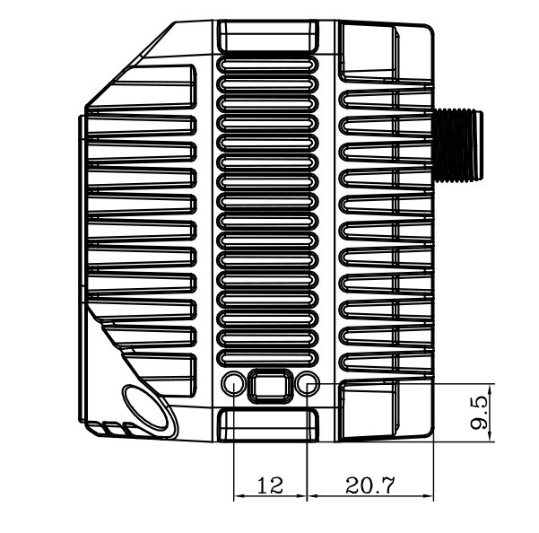
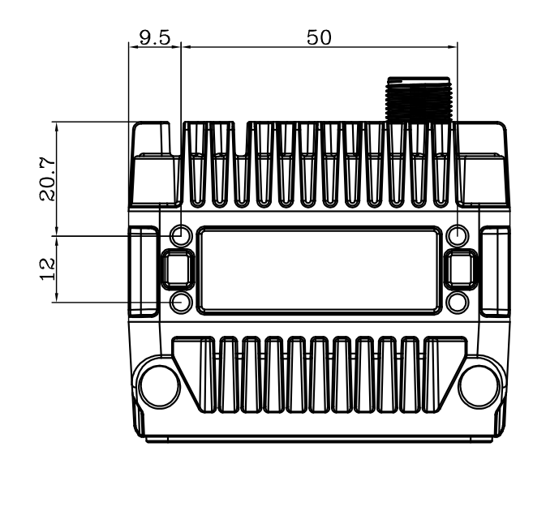
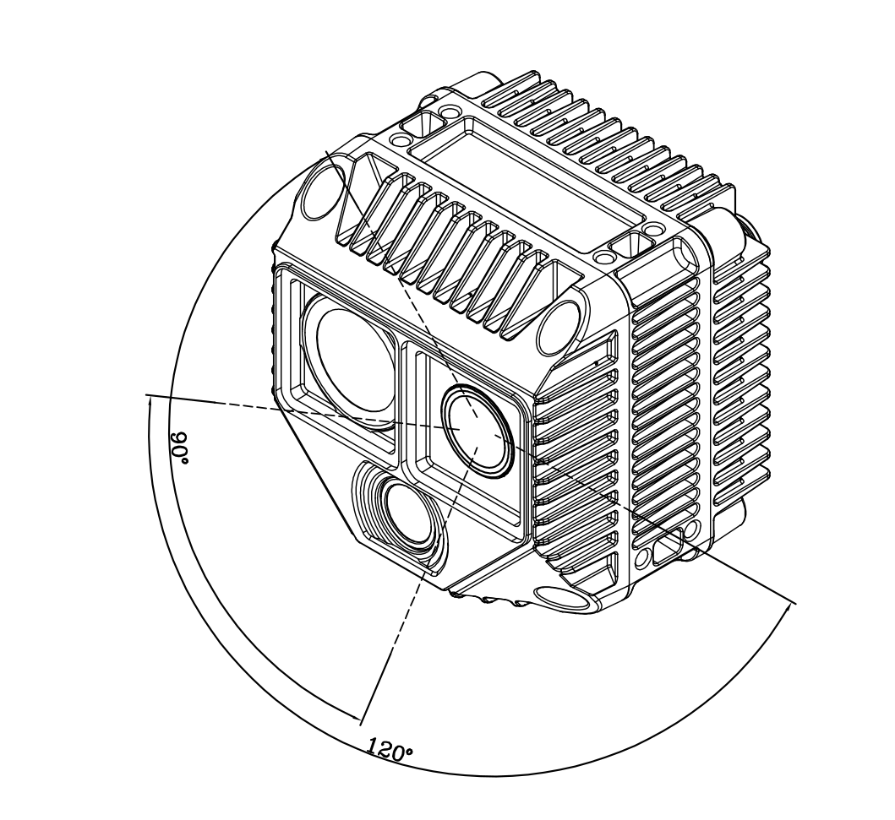
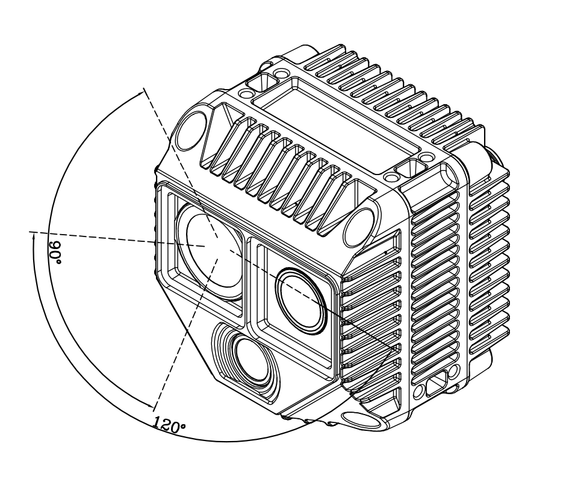
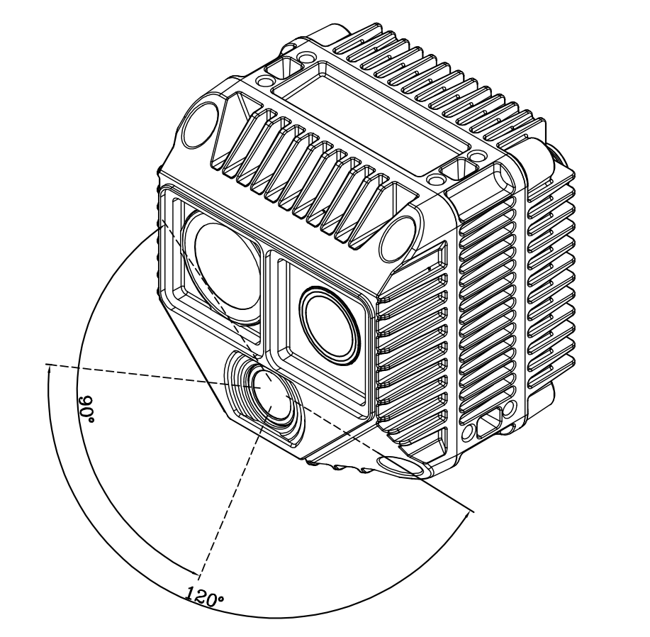

# 3. 安装指南

正式安装 Odin1 Lite 前，请阅读以下注意事项：

1. **清洁安装表面与窗口：**
   - 安装前，务必清除安装位置和激光雷达光学窗口上的灰尘、油污等脏污。建议使用干净的气吹除尘，再用无绒布（如镜头布）沾少许清水轻轻擦拭窗口，确保完全清洁。残留污渍会影响测量精度。请勿使用有刺激性的液体进行清理。

2. ⚠️ **确保视野无遮挡：**
   - 安装时，传感器前方视场角（FOV）区域不允许有任何遮挡物。特别注意：即使是透明的玻璃、亚克力板等，安装在传感器正前方也会显著干扰激光信号，导致性能下降。

3. **灵活的安装方向（含优化建议）：**
   - 本产品支持任意方向安装（包括倒装）。
   - 设备会自动适应安装姿态（如倒装、倾斜），内部传感器会进行校准到重力系。

4. ⚠️ **禁止施加额外负载：**
   - 设备的机身（尤其是散热外壳和光学窗口）不能承受额外重量或压力。请仅通过设计好的安装接口（如底部的螺纹孔）进行固定。

5. ⚠️ **保障散热空间：**
   - 设备四周需留出足够的空间用于散热。要求：设备本体与周围物体的最小净空距离 ≥ 10mm，确保空气能顺畅流通，防止过热。

6. **稳固安装：**
   - 强烈建议将设备安装在结实的支架上，传感器下底部距离物体 0.2 米以上，以防遮挡视野。

7. ⚠️ **严禁正负极反接：**
   - 请仔细阅读使用说明及线序定义。

## 3.1 机械安装

| 背部M3安装孔 | 左右两侧M3安装孔 | 上下两侧M3安装孔 |
| :---: | :---: | :---: |
||||

有效视场角（FOV）范围：

| TX | RX | RGB |
| :-: | :-: | :-: |
|  |  |  |

## 3.2 数模文件

- [下载 Odin1 Lite 数模文件（stp）](assets/stp/O1-Lite-20260506-V1.1.stp)
- [下载 Odin1 Lite 带视场角数模文件（stp）](assets/stp/O1-LiteV1.1-20260513带视场角脱敏版本.stp)

---

[← 上一章：硬件说明](2.%20HW%20Description_)　｜　[下一章：电源与连接 →](4.%20Power%20connection)
