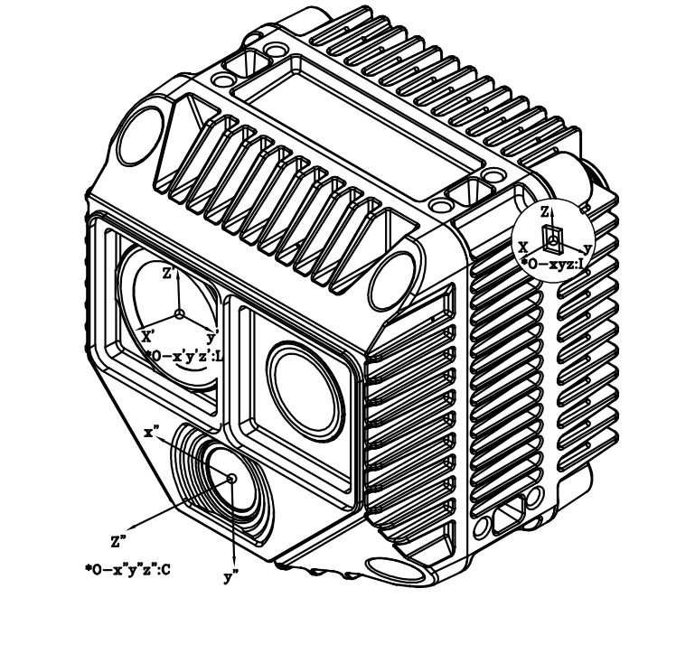

# 5. 数据输出

## 5.1 坐标系定义

Odin1 Lite 直角坐标的定义如下图所示，**I** 为 IMU（即 Body，二者为同一物理位置，仅命名不同）坐标系，**L** 为点云坐标系，**C** 为相机坐标系。



## 5.2 外参描述

### 外参符号说明

下面使用 $\mathbf{T}^{\text{A}}_{\text{B}}$ 来表示坐标转换，具体含义为：

$$\mathbf{P}_{\text{A}} = \mathbf{T}^{\text{A}}_{\text{B}} \cdot \mathbf{P}_{\text{B}}$$

其中 $P_A$ 和 $P_B$ 分别表示物体在 A 坐标系和 B 坐标系下的坐标。

### Camera - LiDAR

外参 $\mathbf{T}^{\text{camera}}_{\text{lidar}}$ 不同机器存在差异，请在驱动程序启动后，在 `config/calib.yaml` 中获取（`Tcl_0`），具体信息请查看驱动。

### Body - LiDAR

> **说明**：此处的 **Body** 即原来的 **IMU**，仅命名（表述）不同，实际对应同一个物理位置。

Body（原 IMU）到 LiDAR 的外参 $\mathbf{T}^{\text{body}}_{\text{lidar}}$（标定文件中的 `body_T_lidar`）如下：

$$\mathbf{T}^{\text{body}}_{\text{lidar}} = \begin{bmatrix} 0.9999543679 & -0.0086157257 & 0.0041269153 & -0.0305398721 \\ 0.0086800624 & 0.9998369581 & -0.0158339418 & 0.0234679052 \\ -0.0039898215 & 0.0158690412 & 0.9998661185 & 0.0333162287 \\ 0 & 0 & 0 & 1 \end{bmatrix}$$

### 其他

- 如需 Camera 到 Body 的外参，请根据上述自行计算。

## 5.3 内参说明

内参主要讨论相机内参，LiDAR 内参不考虑。

### 5.3.1 Odin1 Lite 相机内参

- 获取内参的方法：
  - **方式一（运行时）**：驱动启动后会从设备拉取标定文件并保存到 `~/catkin_ws/src/ros_driver/config/camera_calib_<SN>.yaml`，每台设备各异。
  - **方式二（ROS 服务）**：运行 `ros2 service call /manifold/device0/get_calibration odin_ros_driver_rev1/srv/GetCalibration "{}"` 直接获取 YAML 字符串。实际服务前缀请以启动日志或 `ros2 service list` 为准。
  - **方式三（HTTP Dashboard）**：浏览器访问 `http://192.168.1.251:8080`，在 Dashboard → 标定文件管理中下载。


```shell    
# O1L-P040100047
cam_num: 1
img_topic_0: /camera/rgb
Tcl_0: [
  0.01814, -0.99980, -0.00813, 0.00579,
  -0.00071, 0.00812, -0.99997, -0.03109,
  0.99984, 0.01815, -0.00057, -0.01629,
  0.00000, 0.00000, 0.00000, 1.00000
]

cam_0_640_544:
        cam_model: FishPoly
        image_width: 640
        image_height: 544
        k2: 3.9309765393149745e-02
        k3: 1.5817608030575755e-01
        k4: 5.8836988291029024e-01
        k5: -8.2827749950756613e-01
        k6: 3.8543134263557260e-01
        k7: -6.3564147672175983e-02
        p1: 0.
        p2: 0.
        A11: 2.3172737533779440e+02
        A12: -4.1424461677121709e-02
        A22: 2.3167070553813502e+02
        u0: 3.1331230979976016e+02
        v0: 2.7959256780073559e+02
        isFast: 0
        numDiff: 3000
        maxIncidentAngle: 120

cam_0_1280_1088:
        cam_model: FishPoly
        image_width: 1280
        image_height: 1088
        k2: 3.9309765393149745e-02
        k3: 1.5817608030575755e-01
        k4: 5.8836988291029024e-01
        k5: -8.2827749950756613e-01
        k6: 3.8543134263557260e-01
        k7: -6.3564147672175983e-02
        p1: 0.
        p2: 0.
        A11: 4.6345475067558880e+02
        A12: -8.2848923354243417e-02
        A22: 4.6334141107627005e+02
        u0: 6.2662461959952032e+02
        v0: 5.5918513560147119e+02
        isFast: 0
        numDiff: 3000
        maxIncidentAngle: 120


    
```

### 5.3.2 相机模型描述

#### Odin1 Lite RGB 相机模型与内参

本文档描述 Odin1 Lite RGB 相机的投影模型及内参参数，供工程参考。

#### 1 相机投影模型

Odin1 Lite RGB 使用**多项式鱼眼投影模型**描述大视场成像。去畸变后，该模型可简化为标准**针孔模型**。

#### 2 多项式鱼眼模型

##### 2.1 投影公式

给定相机坐标系下的三维点 $\mathbf{P_c} = (X, Y, Z)^T$，计算入射半径：

$$r = \sqrt{X^2 + Y^2}$$

计算入射角：

$$\theta = \arccos\left(\frac{Z}{\sqrt{X^2 + Y^2 + Z^2}}\right)$$

多项式径向映射：

$$\theta_d = \theta + k_2\theta^2 + k_3\theta^3 + k_4\theta^4 + k_5\theta^5 + k_6\theta^6 + k_7\theta^7$$

投影到畸变平面：

$$x_d = \frac{\theta_d}{r} \cdot X, \quad y_d = \frac{\theta_d}{r} \cdot Y$$

##### 2.2 仿射变换

$$\begin{bmatrix} u \\ v \end{bmatrix} = \begin{bmatrix} A_{11} & A_{12} \\ 0 & A_{22} \end{bmatrix} \begin{bmatrix} x_d \\ y_d \end{bmatrix} + \begin{bmatrix} u_0 \\ v_0 \end{bmatrix}$$

| 参数 | 说明 |
|---|---|
| k2–k7 | 多项式畸变系数 |
| A11 | X 轴焦距（水平缩放） |
| A12 | 非正交补偿（skew） |
| A22 | Y 轴焦距（垂直缩放） |
| u0, v0 | 主点坐标 |

#### 2.3 去畸变后的针孔模型

$$u = f_x \frac{X}{Z} + c_x, \quad v = f_y \frac{Y}{Z} + c_y$$

#### 2.4 坐标系约定

Odin1 Lite RGB 遵循 OpenCV 相机坐标系：X → 右，Y → 下，Z → 前（右手坐标系）。

#### 2.5 工程注意事项

- 去畸变不改变外参。
- 高精度重投影请使用多项式鱼眼模型。
- 检测、SLAM、融合等算法框架请使用去畸变后的针孔模型。
- 当 $\theta \to 0$ 时可能出现数值不稳定（$r \to 0$ 导致除零）。

## 5.4 数据说明

原始点云（`cloud/raw`，分辨率 256×192）PointCloud2 字段如下：

| 字段 | 数据类型 | 说明 |
|:--|:--|:--|
| `x` | FLOAT32 | X 轴，单位：米 |
| `y` | FLOAT32 | Y 轴，单位：米 |
| `z` | FLOAT32 | Z 轴，单位：米 |
| `intensity` | UINT8 | 反射率，范围 0–255 |
| `confidence` | UINT8 | 点置信度，范围 0–255，越高越可信。建议阈值：室内场景 4，可通过 `confidence_threshold` 参数调整 |
| `offset_time` | FLOAT32 | 相对于帧基准时间戳的时间偏移，单位：秒 |

> 注：当点的 `confidence` 低于 `confidence_threshold` 时，驱动会将该点的 x/y/z 置为 0。`point_step` = 18 字节。

## 5.5 ROS 话题与服务一览

> 包名：`odin_ros_driver_rev1`，主节点：`odin_ros_driver_node`，后处理节点：`post_process_node`。
>
> 所有话题和服务均带有逐设备前缀 `{prefix} = /{topic_prefix}/device{N}/`（默认 `/manifold/device0/`）。下表中仅列出后缀部分。
>
> ℹ️ 设备型号不再出现在话题/服务路径中；型号与 SN 由 `/{topic_prefix}/driver/device_online` 的 JSON 字段发布。
>
> ℹ️ 话题 / 字段名中出现的 `imu` 与本文档所称 **Body** 为同一概念（同一物理位置，仅命名不同）。

### 5.5.1 主驱动节点（odin_ros_driver_node）

| 话题后缀 | 类型 | 说明 |
|:--|:--|:--|
| `cloud/raw` | `sensor_msgs/PointCloud2` | 原始点云（256×192）|
| `cloud/slam` | `sensor_msgs/PointCloud2` | SLAM 点云 |
| `camera0/compressed` | `sensor_msgs/CompressedImage` | 左 RGB 相机 JPEG 压缩图像 |
| `camera1/compressed` | `sensor_msgs/CompressedImage` | 右 RGB 相机 JPEG 压缩图像（仅在双目设备有效）|
| `gray` | `sensor_msgs/Image` | 灰度图像（mono8）|
| `imu` | `sensor_msgs/Imu` | IMU（加速度 + 角速度）|
| `odometry_lf` | `nav_msgs/Odometry` | 低频里程计（含位姿协方差）|
| `odometry_hf` | `nav_msgs/Odometry` | 高频里程计（含位姿协方差）|

此外，主驱动还会在驱动级命名空间 `/{topic_prefix}/driver/` 下发布以下话题（不带设备前缀，所有设备共享）：

| 话题 | 类型 | 说明 |
|:--|:--|:--|
| `/{topic_prefix}/driver/device_online` | `std_msgs/String` | 设备上线事件（latched，JSON 含 SN/型号/prefix/IP）|
| `/{topic_prefix}/driver/device_offline` | `std_msgs/String` | 设备下线事件（latched，JSON 含 SN/型号）|
| `/{topic_prefix}/driver/resolution_change` | `std_msgs/String` | 分辨率变更事件（latched）|

### 5.5.2 后处理与功能节点

| 话题后缀 | 类型 | 说明 |
|:--|:--|:--|
| `camera0/raw` | `sensor_msgs/Image` | 左 RGB 相机解码后图像 |
| `camera1/raw` | `sensor_msgs/Image` | 右 RGB 相机解码后图像（仅在双目设备有效）|
| `camera0/undistort` | `sensor_msgs/Image` | 左 RGB 相机去畸变图像 |
| `camera1/undistort` | `sensor_msgs/Image` | 右 RGB 相机去畸变图像（仅在双目设备有效）|
| `camera0/rect` | `sensor_msgs/Image` | 校正后左图像 |
| `camera1/rect` | `sensor_msgs/Image` | 校正后右图像（仅在双目设备有效）|
| `camera0/camera_info` | `sensor_msgs/CameraInfo` | 校正后左相机内参 |
| `camera1/camera_info` | `sensor_msgs/CameraInfo` | 校正后右相机内参（仅在双目设备有效）|
| `cloud/render` | `sensor_msgs/PointCloud2` | 着色点云（点云 + 图像融合，Lidar 坐标系）|
| `reprojection/overlay` | `sensor_msgs/Image` | 点云重投影到相机图像的叠加结果 |
| `pointcloud2depth/depth` | `sensor_msgs/Image`（32FC1） | 稠密深度图，单位米，`0` 表示无效像素 |
| `pointcloud2depth/depth_color` | `sensor_msgs/Image`（bgr8） | JET 配色深度图 |
| `pointcloud2depth/depth_overlay` | `sensor_msgs/Image`（bgr8） | 深度图与相机图像叠加结果 |

> ℹ️ Odin1 Lite 为单目 RGB。驱动代码内保留的 `camera1/*`、`stereo/*` 等双目 / 视差点云相关话题在 Odin1 Lite 上不会发布数据。

### 5.5.3 点云压缩传输

`cloud/raw` 与 `cloud/slam` 的基础话题始终为标准 `sensor_msgs/PointCloud2`，可直接在 RViz 中订阅。安装压缩插件并重启驱动后，会额外提供 `/zlib`、`/zstd`、`/draco` 压缩子话题：

```bash
# ROS2 Humble；请按实际 ROS 发行版替换 humble
sudo apt install ros-humble-point-cloud-transport-plugins
```

> RViz 无法直接显示压缩点云；如需可视化，须使用 `point_cloud_transport republish` 解压为普通 `PointCloud2`。仅使用未压缩点云时无需安装插件。

### 5.5.4 服务

| 服务后缀 | 类型 | 说明 |
|:--|:--|:--|
| `get_calibration` | `odin_ros_driver_rev1/srv/GetCalibration` | 获取相机标定 YAML 内容 |
| `set_sensor_mode` | `odin_ros_driver_rev1/srv/SetSensorMode` | 切换 Sensor Mode（0=HDR / 1=High Peak / 2=Low Peak / 3=Adaptive）|
| `reset_initial_pose` | `odin_ros_driver_rev1/srv/ResetInitialPose` | 重置 SLAM 初始位姿、地图和因子图 |
| `get_adaptive_param` / `set_adaptive_param` | `GetAdaptiveParam` / `SetAdaptiveParam` | 查询 / 设置自适应模式参数，仅 Adaptive 模式生效 |
| `get_sync_mode` / `set_sync_mode` | `GetSyncMode` / `SetSyncMode` | 查询 / 设置默认时间同步模式；设置后需重启设备 |
| `get_ptp_sync_status` | `odin_ros_driver_rev1/srv/GetPtpSyncStatus` | 查询 PTP 同步状态、偏移、链路延迟与频率调整 |
| `restore_default_config` | `odin_ros_driver_rev1/srv/RestoreDefaultConfig` | 恢复设备出厂配置；执行后需重启设备 |
| `device_mode` | `odin_ros_driver_rev1/srv/DeviceMode` | 设置设备模式（0=Standby / 1=Normal / 2=Upgrade / 3=SLAM / 4=Relocation / 5=ReMap）|
| `save_map` | `odin_ros_driver_rev1/srv/SaveMap` | 保存闭环地图到主机文件 |
| `load_map` | `odin_ros_driver_rev1/srv/LoadMap` | 从主机文件加载地图用于重定位或 ReMap |
| `exploy_map` | `odin_ros_driver_rev1/srv/ExployMap` | 将当前闭环地图导出到主机文件（具体格式由插件实现）|
| `set_diag_monitor` | `odin_ros_driver_rev1/srv/SetDiagMonitor` | 启用 / 关闭 1Hz 帧率与延迟诊断，并发布 `/diagnostics` |
| `set_channel_config` / `get_channel_config` | `SetChannelConfig` / `GetChannelConfig` | 批量设置 / 查询主驱动 A 层数据通道开关 |
| `set_post_process_config` / `get_post_process_config` | `SetPostProcessConfig` / `GetPostProcessConfig` | 批量设置 / 查询后处理 B 层开关；服务前缀为 `/{topic_prefix}/postprocess/` |

## 5.6 ROS Driver 获取

Odin1 Lite ROS 驱动：https://git.manifoldtech.cn/manifoldtech-sdk/odin_ros_driver2

Odin1 Lite sdk:https://git.manifoldtech.cn/manifoldtech-sdk/odin-sdk2

详细部署与运行步骤请参见 [7. Odin1 Lite 快速启动（Ubuntu）](7.%20Odin1Lite%20Quick%20start%20for%20ubuntu)。

---

[← 上一章：电源与连接](4.%20Power%20connection)　｜　[下一章：建图与重定位建议调用流程 →](6.%20map%20and%20relocalizaiton%20api)
